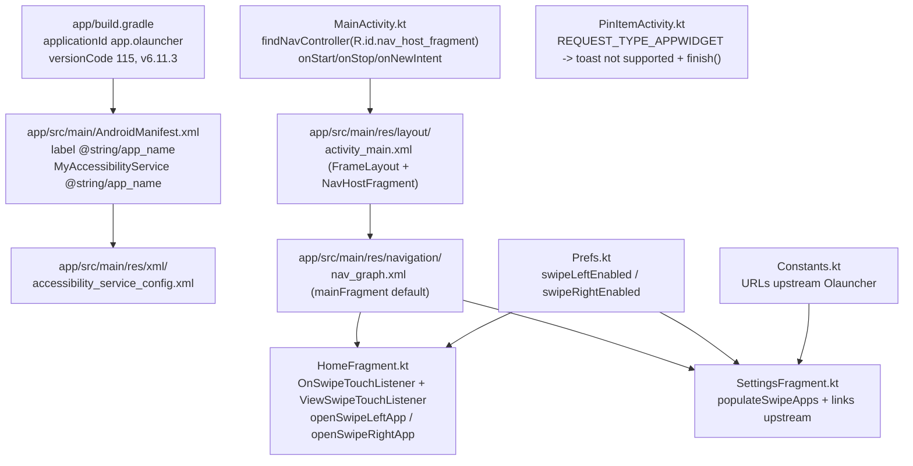
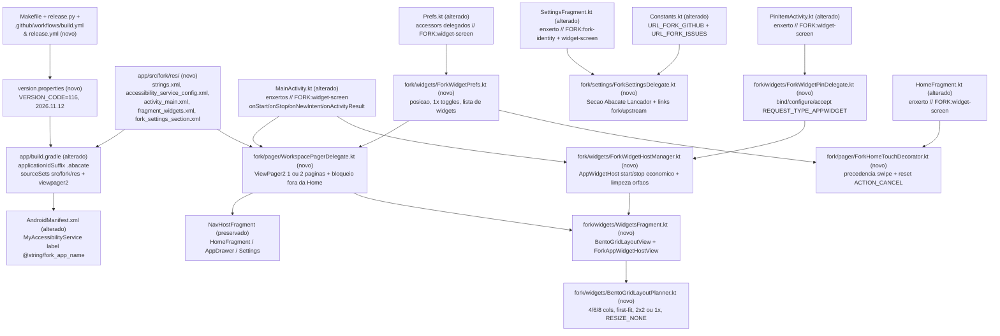

# Design & Technical Plan

## Context & Architecture Grounding

Conforme motivado em [proposal.md](proposal.md), esta mudança estabelece a fundação estrutural do fork **Abacate Lançador** (`app.olauncher.abacate`) e entrega a **Tela Dedicada de Widgets** com transição física via `ViewPager2` e layout Bento Grid responsivo.

Fontes arquiteturais consultadas e regras impostas ao desenho:
1. **`AGENTS.md`**: define stack Kotlin 2.1.20 / Java 17, `compileSdk`/`targetSdk` 36, `minSdk` 24, MVVM com Jetpack Navigation, persistência encapsulada em `app.olauncher.data.Prefs`, testes JUnit 4 em `app/src/test/java/app/olauncher`, comandos `./gradlew assembleDebug` e `./gradlew testDebugUnitTest`, proibição estrita de anúncios/tracking e conformidade com GNU GPLv3.
2. **`docs/agents/architecture.md`**: estabelece a arquitetura **Single-Activity MVVM** (`MainActivity` gerenciando `NavHostFragment`, lifecycle e insets; `MainViewModel` coordenando estado via `LiveData`; `Prefs` isolando `SharedPreferences`; `ui/` restrito a binding, gestos e navegação; `helper/` e `listener/` encapsulando serviços de SO e touch).
3. **`docs/agents/domain_rules.md`**: preserva intactas as regras de busca (`AppSearchMatcher`), identidade de atalhos (`ShortcutIdentity`), agendamento de papel de parede (`WallpaperWorker`), máquina de estados de diálogos (`MainActivity.checkForMessages()`), slots da Home (`1..8`) e Private Space (`Android 15+`).
4. **`docs/agents/coding_guidelines.md`**: exige eventos de UI one-shot via `SingleLiveEvent`, I/O fora da main thread, acesso tipado de estado em `Prefs` com `androidx.core.content.edit` e preservação de testabilidade JVM pura para regras de domínio.

**Princípio estrutural do Fork (Isolamento por Delegate/Decorator & Overlay):**
Todo código exclusivo do fork reside sob `app/src/main/java/app/olauncher/fork/` e todo recurso exclusivo sob `app/src/fork/res/`. Arquivos compartilhados com o upstream recebem exclusivamente enxertos de linha única demarcados por `// FORK:<feature>` (ou `<!-- FORK:<feature> -->` em XML) delegando para os módulos do fork, acompanhados da política **Zero Lixo de Compatibilidade** (nenhum código morto, alias legado ou fallback inútil mantido após migração).

---

## Goals / Non-Goals

**Goals:**
- Garantir coexistência lado a lado com o Olauncher upstream via `applicationIdSuffix = ".abacate"` (`app.olauncher.abacate` / `app.olauncher.abacate.debug`), rótulo `"Lançador"` no sistema/gaveta e `"Abacate Lançador"` internamente e no serviço de acessibilidade.
- Automatizar versionamento CalVer (`version.properties` `2026.11.12` / `116`), `Makefile`, `app/src/fork/tools/release.py`, `CHANGELOG.md`, `README.md` com Obtainium e workflows `.github/workflows/build.yml` e `release.yml`.
- Implementar a Tela Dedicada de Widgets com deslizamento físico em `ViewPager2` (`WorkspacePagerDelegate`), mantendo o papel de parede contínuo e bloqueando swipe lateral fora de `HomeFragment`.
- Implementar `BentoGridLayoutPlanner` em Kotlin puro (testável na JVM) com grades responsivas Apple (`4`/`6`/`8` colunas), empacotamento *first-fit* sem sobreposição nem lacunas órfãs e respeito a `RESIZE_NONE` e mínimos `2x2` / `1x`.
- Gerenciar ciclo de vida econômico de `AppWidgetHost`, adição por toque longo no fundo, pinning externo via `PinItemActivity` e edição puramente por gestos via `ForkAppWidgetHostView`.

**Non-Goals:**
- Inserir widgets dentro da própria `HomeFragment` ou alterar o layout/minimalismo de `fragment_home.xml`.
- Alterar algoritmos de busca em `AppDrawerFragment`, lógica de Private Space ou `WallpaperWorker`.
- Suportar múltiplas telas de widgets além de uma única tela configurável (`Desativada`, `Esquerda`, `Direita`).
- Introduzir bibliotecas de anúncios, analytics ou incompatíveis com GNU GPLv3.

---

## AS IS — Estado e Componentes Atuais

*Legenda (AS IS): Fluxo atual do Olauncher upstream verificado diretamente no código-fonte (`app/build.gradle`, `AndroidManifest.xml`, `activity_main.xml`, `nav_graph.xml`, `MainActivity.kt`, `HomeFragment.kt`, `SettingsFragment.kt`, `PinItemActivity.kt`, `Prefs.kt`, `Constants.kt`). Não há infraestrutura de fork, `ViewPager2` nem suporte a `AppWidgetHost` ou `REQUEST_TYPE_APPWIDGET`.*

---

## TO BE — Estado e Componentes Propostos

*Legenda (TO BE): Arquitetura proposta isolando identidade, build CalVer e automação (RF-01, RF-02, RF-04), governança de enxertos `// FORK:<feature>` e overlay `app/src/fork/res/` (RF-03), configurações e precedência de gestos (RF-05), paginação física em `ViewPager2` via `WorkspacePagerDelegate` (RF-06), motor `BentoGridLayoutPlanner` (RF-07), ciclo de vida `AppWidgetHost` e pinning externo via `PinItemActivity` (RF-08) e edição puramente por gestos em `WidgetsFragment` com `ForkAppWidgetHostView` (RF-09), mantendo `HomeFragment` minimalista e verificada por build/testes/lint (RNF-01).*

---

## RIGID vs FLEXIBLE Boundaries

### RIGID (Non-Negotiable)
1. **Identidade Dual & GPLv3 (RF-01)**:
   - `defaultConfig` DEVE definir `applicationIdSuffix = ".abacate"` mantendo `applicationIdSuffix ".debug"` no buildType `debug` (`app.olauncher.abacate` e `app.olauncher.abacate.debug`).
   - `fork_label_name` = `"Lançador"` (usado em `app_name` via overlay `app/src/fork/res/values/strings.xml` para gaveta/sistema); `fork_app_name` = `"Abacate Lançador"` (usado em `MyAccessibilityService` e UI interna do fork).
   - `app/src/fork/res/xml/accessibility_service_config.xml` DEVE declarar `android:packageNames="app.olauncher.abacate, app.olauncher.abacate.debug, app.olauncher.debug, app.olauncher"`.
   - `LICENSE` (GPLv3) e todas as constantes upstream em `Constants.kt` (`URL_ABOUT_OLAUNCHER`, `URL_OLAUNCHER_GITHUB`, `URL_TWITTER_TANUJ`, `URL_OLAUNCHER_PRIVACY`, etc.) DEVEM permanecer intactas.
2. **Versionamento CalVer, Ferramentas & CI/CD (RF-02, RF-04)**:
   - `version.properties` na raiz com `VERSION_CODE=116` e `VERSION_NAME=2026.11.12`, lido dinamicamente por `app/build.gradle`.
   - `Makefile` (`release`, `dry-run`, `test`, `install`), `app/src/fork/tools/release.py` (`--dry-run` retornando `0`), `CHANGELOG.md`, `README.md` com badge Obtainium para `app.olauncher.abacate`, `.github/workflows/build.yml` (JDK 17, `assembleDebug`, `testDebugUnitTest`) e `release.yml` (tags `v*`, APK assinado + notas de `CHANGELOG.md`).
   - Git remote `origin` apontando para `https://github.com/eusoumadson/abacate-launcher.git`.
3. **Isolamento & Zero Lixo de Compatibilidade (RF-03)**:
   - Código exclusivo do fork em `app/src/main/java/app/olauncher/fork/` e recursos exclusivos em `app/src/fork/res/`.
   - Arquivos compartilhados com o upstream (`app/build.gradle`, `gradle/libs.versions.toml`, `AndroidManifest.xml`, `MainActivity.kt`, `HomeFragment.kt`, `SettingsFragment.kt`, `PinItemActivity.kt`, `Prefs.kt`, `Constants.kt`) só podem conter enxertos mínimos marcados com `// FORK:<feature>` (ou `<!-- FORK:<feature> -->`), todos catalogados em `docs/fork/FORK_INTEGRATION.md`.
   - `AGENTS.md` e `docs/agents/coding_guidelines.md` DEVEM registrar a política **Zero Lixo de Compatibilidade**.
4. **Configurações & Precedência de Gestos (RF-05)**:
   - Seção `"Abacate Lançador"` em `SettingsFragment` com posição (`Desativada` padrão, `Esquerda`, `Direita`), toggles `allowMinWidth1` (`false` padrão) e `allowMinHeight1` (`false` padrão), versão e links do fork/upstream.
   - Ativar um lado (`Esquerda` ou `Direita`) desabilita a abertura de app no gesto correspondente (`openSwipeRightApp` quando Widgets está à `Esquerda`; `openSwipeLeftApp` quando Widgets está à `Direita`), mantendo o gesto oposto intacto.
5. **Paginação Física `ViewPager2` (RF-06)**:
   - Overlay `app/src/fork/res/layout/activity_main.xml` + `WorkspacePagerDelegate`.
   - Quando `NavController.currentDestination?.id != R.id.mainFragment`, `ViewPager2.isUserInputEnabled` DEVE ser `false`.
   - Retorno da `WidgetScreen` para a Home DEVE funcionar via swipe oposto, `OnBackPressedCallback` e botão Home (`MainActivity.onNewIntent`).
6. **Motor `BentoGridLayoutPlanner` (RF-07)**:
   - Colunas responsivas Apple: `< 600dp -> 4`, `600dp..839dp -> 6`, `>= 840dp -> 8`.
   - Alocação *first-fit* determinística sem sobreposição de células nem lacunas órfãs anteriores que comportem o item.
   - Mínimo padrão `2x2`, reduzível para largura `1` (`allowMinWidth1`) e/ou altura `1` (`allowMinHeight1`).
   - Widgets com `resizeMode == AppWidgetProviderInfo.RESIZE_NONE` centralizados na célula alocada e sem alças de redimensionamento.
7. **Ciclo de Vida `AppWidgetHost`, Adição & Pinning (RF-08)**:
   - `startListening()` em `MainActivity.onStart()` e `stopListening()` em `onStop()` executados SOMENTE quando Tela de Widgets ativa E `>= 1` widget salvo (e `stopListening()` apenas se estiver escutando).
   - IDs órfãos (`AppWidgetManager.getAppWidgetInfo(id) == null`) removidos e liberados via `deleteAppWidgetId()` na carga.
   - Toque longo no fundo vazio da `WidgetScreen` dispara `ACTION_APPWIDGET_PICK` -> `ACTION_APPWIDGET_BIND` -> `ACTION_APPWIDGET_CONFIGURE`.
   - `PinItemActivity` aceita e vincula `REQUEST_TYPE_APPWIDGET` quando ativo; quando `Desativada`, mantém `R.string.widgets_not_supported`.
8. **Edição Puramente por Gestos & Isolamento da Home (RF-09)**:
   - `ForkAppWidgetHostView` intercepta toque longo sobre qualquer widget com `HapticFeedbackConstants.LONG_PRESS` entrando em modo edição (Drag & Drop de reordenação, alças de redimensionamento na grade e ação de remoção).
   - Toque fora dos controles em edição encerra o modo edição e persiste ordem/spans.
   - Zero botões estáticos (`+` ou `Editar`) na `WidgetScreen`; zero alterações visuais/widgets na `HomeFragment`.

### FLEXIBLE (Implementation Autonomy)
- Subpacotes internos sob `app.olauncher.fork.*` (`widgets`, `pager`, `settings`) e nomes de helpers privados.
- Formato de serialização da lista de widgets em `ForkWidgetPrefs` (JSON via `org.json.JSONArray` nativo do Android SDK, evitando dependências externas extras).
- Estilo visual das alças de redimensionamento, borda tracejada/contínua do widget em edição e badge de remoção (desde que siga os atributos de tema `?attr/primaryColor` e `?attr/primaryShadeDarkColor` sem introduzir cores fixas incompatíveis com tema claro/escuro/e-ink).

---

## Decisions

### D1: `ViewPager2` em Overlay `activity_main.xml` com Reparenting Seguro de `NavHostFragment`
- **Escolha**: Manter `<fragment android:id="@+id/nav_host_fragment" ...>` declarado no overlay `app/src/fork/res/layout/activity_main.xml` ao lado de `<androidx.viewpager2.widget.ViewPager2 android:id="@+id/workspacePager" .../>`, gerenciado por `WorkspacePagerDelegate`.
- **Justificativa**: `MainActivity.kt:86` executa `this.findNavController(R.id.nav_host_fragment)` imediatamente após `setContentView(binding.root)`. Se `nav_host_fragment` fosse criado apenas assincronamente dentro de um `FragmentStateAdapter`, `findNavController` lançaria `IllegalStateException`. Com o overlay:
  - No modo `Desativada` (padrão), `workspacePager` fica `View.GONE` e `nav_host_fragment` permanece filho direto de `mainActivityLayout` — zero overhead e comportamento 100% idêntico ao upstream.
  - No modo `Esquerda` ou `Direita`, `WorkspacePagerDelegate` usa um `RecyclerView.Adapter` de 2 páginas estáveis (`setHasStableIds(true)`, `offscreenPageLimit = 1`, `holder.setIsRecyclable(false)`): uma página recebe a view de `nav_host_fragment` (reparentada uma única vez) e a outra hospeda `WidgetsFragment` via `FragmentContainerView` (`supportFragmentManager`). Quando o usuário está no `WidgetsFragment` (página de widgets) e navega/volta para `Desativada`, a view de `nav_host_fragment` é devolvida a `mainActivityLayout`.
- **Alternativa descartada**: Envolver `NavHostFragment` em um `HomeContainerFragment` dentro de `FragmentStateAdapter`, pois obrigaria alterar `MainActivity.onCreate` para adiar `findNavController` e quebraria a linha `val navController = findNavController(R.id.nav_host_fragment)` em futuras sincronizações upstream.

### D2: Direção do Swipe vs `OnSwipeTouchListener` / `ViewSwipeTouchListener`
- **Escolha**: Aproveitar o comportamento nativo de interceptação do `ViewPager2` combinado com `ForkHomeTouchDecorator` (enxerto único em `HomeFragment.initSwipeTouchListener()`).
- **Mecanismo**:
  - `HomeFragment` usa `OnSwipeTouchListener` e `ViewSwipeTouchListener` cujo `onDown` retorna `true`. Quando o usuário arrasta na direção da Tela de Widgets (ex.: swipe para direita com `WidgetScreen` à `Esquerda`), `ViewPager2` possui scroll disponível nessa direção, intercepta `ACTION_MOVE` após `touchSlop`, envia `ACTION_CANCEL` para `HomeFragment` e desliza pixel a pixel para a `WidgetScreen`.
  - Na direção oposta (ex.: swipe para esquerda quando `WidgetScreen` está à `Esquerda`), `ViewPager2` está na borda, não intercepta e `HomeFragment` executa `openSwipeLeftApp()` normalmente.
  - `ForkHomeTouchDecorator` envolve os listeners de toque em `HomeFragment` apenas para limpar `view.isPressed = false` em `ACTION_CANCEL` (evitando texto preso em estado pressionado após interceptação do `ViewPager2`) e `HomeFragment.openSwipeLeftApp` / `openSwipeRightApp` recebem guarda explícita (`RF-05`) impedindo abertura do app quando aquele lado está ocupado pela `WidgetScreen`.
- **Alternativa descartada**: Reimplementar `OnSwipeTouchListener` para propagar eventos manualmente ao `ViewPager2` — exigiria editar arquivos upstream de listener sem necessidade.

### D3: `BentoGridLayoutPlanner` em Kotlin Puro (JVM)
- **Escolha**: Separar totalmente o cálculo de grade (`BentoGridLayoutPlanner`, `GridBreakpoint`, `WidgetPlacementInput`, `WidgetPlacementOutput`) de classes Android (`AppWidgetHostView`, `ViewGroup`), usando apenas tipos primitivos e `data class` Kotlin.
- **Justificativa**: Permite validar exaustivamente os breakpoints (`4`/`6`/`8`), empacotamento *first-fit*, limites `2x2` vs `1x`, reordenação e `RESIZE_NONE` em `./gradlew testDebugUnitTest` em milissegundos, sem Robolectric.

### D4: `ForkAppWidgetHostView` para Edição por Gestos sem Botões Estáticos
- **Escolha**: Subclassificar `android.appwidget.AppWidgetHostView` em `ForkAppWidgetHostView` dentro de `app/src/main/java/app/olauncher/fork/widgets/`.
- **Mecanismo**:
  - Intercepta `onInterceptTouchEvent` rastreando `ACTION_DOWN` + `ViewConfiguration.getLongPressTimeout()` (e cancelando se houver movimento > `touchSlop` ou `ACTION_UP`/`ACTION_CANCEL`).
  - Ao atingir o tempo de toque longo (sem ser consumido como scroll de widget), dispara `performHapticFeedback(HapticFeedbackConstants.LONG_PRESS)`, entra em modo edição na `WidgetsFragment` e bloqueia temporariamente `ViewPager2.isUserInputEnabled = false` durante o drag/resize para que o gesto de arrastar/redimensionar não dispare troca de página.
  - No modo edição, `BentoGridLayoutView` desenha alças de redimensionamento (para widgets redimensionáveis) e ícone discreto de remoção apenas no widget selecionado ou em todos os cards em edição; um toque no fundo vazio fora dos cards/alças encerra a edição e persiste no `ForkWidgetPrefs`.
  - Toque longo no fundo vazio da `WidgetsFragment` (quando fora de qualquer widget e fora do modo edição) aciona `ACTION_APPWIDGET_PICK` (com retorno tratado em `MainActivity.onActivityResult`).

### D5: `PinItemActivity` com Fluxo Assíncrono Seguro para `REQUEST_TYPE_APPWIDGET`
- **Escolha**: Enxerto único `// FORK:widget-screen` em `PinItemActivity.kt` no branch `REQUEST_TYPE_APPWIDGET` delegando para `ForkWidgetPinDelegate`.
- **Mecanismo**:
  - Se a Tela de Widgets estiver `Desativada`, exibe `R.string.widgets_not_supported` e finaliza (`finish()`), preservando exatamente o upstream.
  - Se ativa (`Esquerda` ou `Direita`), aloca `appWidgetId` via `ForkWidgetHostManager`, tenta `bindAppWidgetIdIfAllowed`; se necessário, inicia `ACTION_APPWIDGET_BIND` (e `ACTION_APPWIDGET_CONFIGURE` se `providerInfo.configure != null`) mantendo `PinItemActivity` aberta até o `onActivityResult` final, aceita o `PinItemRequest` com `Bundle` contendo `EXTRA_APPWIDGET_ID` e grava o widget em `ForkWidgetPrefs` (que emite atualização para `WidgetsFragment`).

### D6: Injeção Dinâmica da Seção `"Abacate Lançador"` em `SettingsFragment` e Identidade de Recursos
- **Escolha**:
  - `app/build.gradle`: define `resValue` `fork_app_name` (`"Abacate Lançador"`) e `fork_label_name` (`"Lançador"`).
  - `app/src/fork/res/values/strings.xml`: sobrescreve `<string name="app_name" translatable="false">@string/fork_label_name</string>` (sem duplicar `fork_app_name`/`fork_label_name` no XML!) e adiciona strings exclusivas do fork. Dessa forma, `AndroidManifest.xml:26` (`android:label="@string/app_name"`) resolve automaticamente para `"Lançador"` na gaveta do sistema sem editar essa linha.
  - `app/src/main/AndroidManifest.xml:94`: enxerto único `<!-- FORK:fork-identity -->` alterando `MyAccessibilityService` para `android:label="@string/fork_app_name"`.
  - `SettingsFragment.kt`: enxerto único delegando para `ForkSettingsDelegate`, que altera o título superior `binding.olauncherHiddenApps.text = getString(R.string.fork_app_name)` e infla `fork_settings_section.xml` dentro de `binding.scrollLayout` (mantendo `fragment_settings.xml` e `layout-land/fragment_settings.xml` 100% intocados para merges upstream!).

---

## Risks / Trade-offs

| Risk | Blast Radius | Mitigation | Rollback |
|---|---|---|---|
| Reparenting de `nav_host_fragment` para dentro de `ViewPager2` perder estado ou quebrar em rotação/recreate | Alto (navegação principal da Activity) | Usar `setHasStableIds(true)`, `offscreenPageLimit = 1`, `setIsRecyclable(false)`, devolver view a `mainActivityLayout` ao desativar, e validar em `onSaveInstanceState` / `recreate()` | Definir `workspacePager.visibility = View.GONE` e remover chamada a `WorkspacePagerDelegate` no enxerto de `MainActivity.kt` |
| Conflito de toque entre `ViewPager2` horizontal e `OnSwipeTouchListener` / `ViewSwipeTouchListener` (estado `isPressed` preso ou disparo duplo de app de swipe) | Médio (gestos da `HomeFragment`) | `ForkHomeTouchDecorator` limpa `isPressed` em `ACTION_CANCEL`; `HomeFragment.openSwipeLeftApp/RightApp` verifica guarda explícita `ForkSwipePolicy` (`RF-05`) | Remover decorator/guarda no enxerto de `HomeFragment.kt` |
| `PinItemActivity` finalizar antes de concluir `ACTION_APPWIDGET_BIND` / `CONFIGURE` | Médio (pinning externo de widgets) | `handleRequestType` retorna controle para `ForkWidgetPinDelegate` controlar `finish()` apenas após conclusão/cancelamento do fluxo assíncrono | Restaurar branch `REQUEST_TYPE_APPWIDGET` para `showToast(R.string.widgets_not_supported)` |
| Vazamento de `AppWidgetHost` ou acúmulo de `appWidgetId` órfãos após desinstalação de app | Baixo/Médio (bateria e persistência) | `startListening()`/`stopListening()` condicionados a estado ativo + `widgets.isNotEmpty()`; limpeza automática de órfãos na carga (`deleteAppWidgetId`) | Chamar `stopListening()` e limpar lista de widgets em `ForkWidgetPrefs` |
| Colisão entre `resValue` em `build.gradle` e `app/src/fork/res/values/strings.xml`, ou perda de strings por `resourceConfigurations` | Baixo (falha de build imediata detectável no `assembleDebug`) | Declarar `fork_app_name`/`fork_label_name` exclusivamente via `resValue` e strings traduzíveis/override em `src/fork/res/values/strings.xml` + `values-pt-rBR/` | Remover duplicata no XML ou ajustar `resValue` |
| Widgets com `minWidth`/`minHeight` grandes ou `RESIZE_NONE` quebrarem empacotamento em 4 colunas | Baixo (layout visual na `WidgetScreen`) | `BentoGridLayoutPlanner` faz clamp de span `[minSpan..columnCount]`, trata `RESIZE_NONE` centralizado sem alças e é coberto por testes JVM para bordas | Ajustar regras de clamp em `BentoGridLayoutPlanner` sem impacto no core |
| Conflitos em futuros `git merge upstream/master` | Baixo (manutenção do fork) | Concentrar alterações em `fork/` + `src/fork/res/`, manter enxertos `// FORK:<feature>` de linha única catalogados em `docs/fork/FORK_INTEGRATION.md` | Reaplicar enxertos a partir do mapa `docs/fork/FORK_INTEGRATION.md` |

---

## Open Questions

Nenhuma questão bloqueante em aberto. Detalhes estéticos menores das alças de redimensionamento (espessura de borda, raio de canto em dp) ficam sob autonomia `FLEXIBLE` na Fase 3 alinhados aos tokens de tema do Olauncher.
