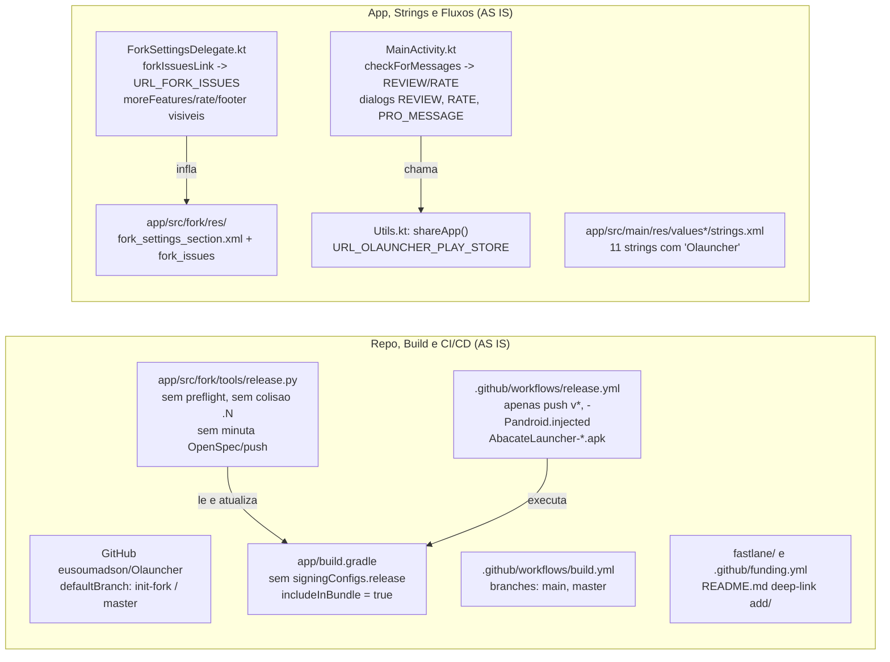
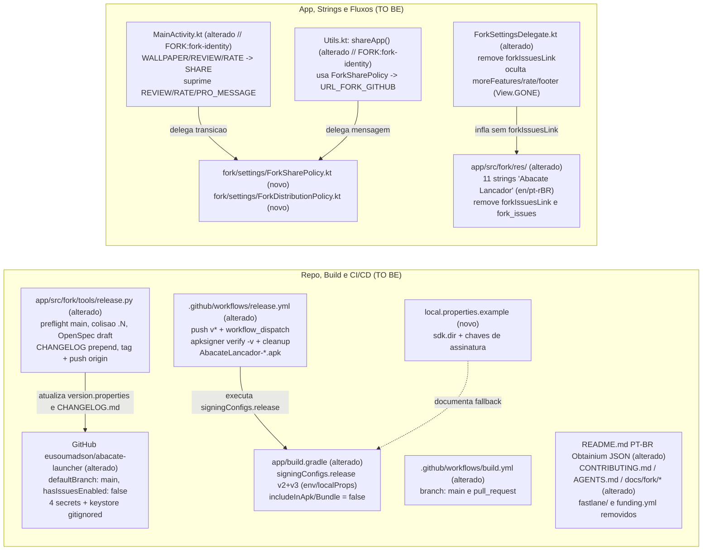

# Design & Technical Plan

## Context & Architecture Grounding

Este plano técnico detalha a consolidação da identidade **Abacate Lançador**, do empacotamento/assinatura de release, da automação CalVer via `release.py`, dos pipelines de CI/CD, da exclusividade de distribuição via GitHub Releases / Obtainium e da remoção dos fluxos internos de loja/avaliação, conforme motivação e critérios definidos em [proposal.md](proposal.md) e [specs/fork-governance/spec.md](specs/fork-governance/spec.md).

O desenho foi fundamentado diretamente na leitura dos seguintes documentos de arquitetura e governança do repositório:
- [AGENTS.md](../../../AGENTS.md): impõe **Fork Isolation** (código exclusivo do fork em `app/src/main/java/app/olauncher/fork/`, ferramentas em `app/src/fork/tools/`, recursos em `app/src/fork/res/` via `sourceSets`, e apenas enxertos mínimos marcados com `FORK:<feature>` em arquivos compartilhados) e **Zero Compatibility Trash** (proíbe código morto, shims ou fallbacks órfãos após refatorações).
- [docs/agents/architecture.md](../../../docs/agents/architecture.md): define a arquitetura MVVM de Activity única (`MainActivity`, `MainViewModel`, fragments de navegação) estendida por delegates em `fork/` e overlays em `app/src/fork/res/`.
- [docs/agents/coding_guidelines.md](../../../docs/agents/coding_guidelines.md): orienta a extração de políticas e regras puras em `object`s Kotlin sem dependências do framework Android (`Context`, `View`, `org.json`) para viabilizar testes unitários puros na JVM com JUnit 4 (sem Robolectric ou frameworks de mock).
- [docs/agents/domain_rules.md](../../../docs/agents/domain_rules.md): estabelece as invariantes atuais de identidade dual (`app.olauncher.abacate` / `app.olauncher.abacate.debug`, `fork_app_name`, `fork_label_name`), `version.properties` e preservação das URLs upstream.
- [docs/fork/FORK_INTEGRATION.md](../../../docs/fork/FORK_INTEGRATION.md) e [docs/fork/FORK_FEATURES.md](../../../docs/fork/FORK_FEATURES.md): catalogam todos os pontos de enxerto `FORK:<feature>` e as regras de não-regressão das features do fork.

## Goals / Non-Goals

**Goals:**
- Consolidar o repositório remoto em `eusoumadson/abacate-launcher` com branch padrão `main` (derivada de `init-fork`), Issues desabilitadas (`hasIssuesEnabled = false`), keystore de release local fora do Git e os quatro secrets no GitHub Actions (`AC-01` / `RF-05`).
- Configurar `signingConfigs.release` em `app/build.gradle` (env vars com fallback em `local.properties` e exemplo em `local.properties.example`), assinatura v2 + v3 (`minSdk 24`) e `dependenciesInfo` desabilitado em APK e Bundle (`AC-02` / `RF-06`).
- Atualizar `.github/workflows/release.yml` (`push` em `v*` e `workflow_dispatch`, assinatura via `signingConfigs.release`, `apksigner verify -v`, asset `AbacateLancador-<version>-release.apk`, artifact em `workflow_dispatch`, limpeza de keystore `if: always()`) e alinhar `.github/workflows/build.yml` à branch `main` (`AC-03` / `RF-04`).
- Evoluir `app/src/fork/tools/release.py` e `test_release.py` no padrão do `abacate-calendario` com preflight (`main` + working tree limpo), colisão `.1`/`.2`, minuta automática a partir de OpenSpec `proposal.md`, `$EDITOR`/entrada manual, inserção em `CHANGELOG.md`, commit/tag anotada e push interativo para `origin` (`AC-04` / `RF-02`).
- Remover `fastlane/` e `.github/funding.yml`, reescrever `README.md` em PT-BR com badge e deep-link JSON 1-toque do Obtainium e créditos GPLv3 ao upstream, e alinhar `CONTRIBUTING.md`, `AGENTS.md`, `docs/fork/*` e `openspec/specs/fork-governance/spec.md` (`AC-05` / `RF-03`, `RF-07`).
- Substituir `"Olauncher"` por `"Abacate Lançador"` nas 11 strings conversacionais via overlay `app/src/fork/res/`, remover completamente `forkIssuesLink`/`fork_issues`/`URL_FORK_ISSUES`, redirecionar `shareApp()` para `Constants.URL_FORK_GITHUB`, ocultar `moreFeatures`/`rate`/`footer` em `ForkSettingsDelegate` (portrait e `layout-land`), e suprimir dialogs e transições de Play Store em `MainActivity` via políticas puras testáveis na JVM (`AC-06`, `AC-07` / `RF-01`, `RNF-01`).

**Non-Goals:**
- Alterar fluxos funcionais da `widget-screen`, `HomeFragment`, `AppDrawerFragment` ou regras de busca/atalhos não ligadas à identidade e distribuição.
- Remover URLs/helpers upstream de `Constants.kt` ou `rateApp()` de `Utils.kt` (preservados pelo princípio de Fork Isolation).
- Configurar publicação na Google Play Store, F-Droid ou IzzyOnDroid.

## AS IS — Estado e Componentes Atuais

O diagrama acima reflete os módulos verificados no estado atual do repositório (`app/build.gradle`, `.github/workflows/build.yml`, `.github/workflows/release.yml`, `app/src/fork/tools/release.py`, `fastlane/`, `.github/funding.yml`, `README.md`, `MainActivity.kt`, `Utils.kt`, `ForkSettingsDelegate.kt`, `app/src/main/res/values*/strings.xml` e `app/src/fork/res/`).

## TO BE — Estado e Componentes Propostos

O estado proposto realiza `RF-05`, `RF-06` e `RF-04` na camada de repositório, Gradle e CI/CD (`T01`–`T05`, `T18`–`T20`), `RF-02` no ferramental `release.py`/`test_release.py` (`T06`–`T09`), `RF-01` e `RNF-01` nos overlays e delegates isolados do app (`T10`–`T14`), e `RF-03` e `RF-07` na limpeza de loja e documentação de governança (`T15`–`T17`).

## RIGID vs FLEXIBLE Boundaries

- **RIGID (Non-Negotiable)**:
  - **Fork Isolation & Zero Lixo**: Todo código Kotlin novo do fork deve residir em `app/src/main/java/app/olauncher/fork/` e todo override de recurso em `app/src/fork/res/`; arquivos compartilhados aceitam somente enxertos mínimos marcados com `// FORK:<feature>` (Kotlin/Gradle) ou `<!-- FORK:<feature> -->` (XML) catalogados em `docs/fork/FORK_INTEGRATION.md`. Nenhum alias ou fallback morto pode permanecer (`forkIssuesLink`, `fork_issues`, `Constants.URL_FORK_ISSUES` devem ser removidos integralmente).
  - **Identidade Dual & Preservação GPLv3**: `applicationIdSuffix = ".abacate"`, `fork_label_name = "Lançador"` em `app_name` e `fork_app_name = "Abacate Lançador"` em acessibilidade/UI interna devem ser preservados; todas as URLs upstream (`Constants.kt`), `rateApp()` (`Utils.kt`), `fragment_settings.xml` (portrait e landscape) e `LICENSE` permanecem intocados.
  - **Assinatura Gradle & Sem Metadados Google**: `signingConfigs.release` deve resolver individualmente `KEYSTORE_FILE`, `KEYSTORE_PASSWORD`, `KEY_ALIAS` e `KEY_PASSWORD` via `System.getenv(k) ?: localProps.getProperty(k)` somente quando os 4 valores existirem e o arquivo da keystore existir no disco; `enableV2Signing = true` e `enableV3Signing = true` são obrigatórios devido a `minSdk 24`; `dependenciesInfo.includeInApk = false` e `includeInBundle = false`.
  - **Contrato de CI/CD (`release.yml` e `build.yml`)**: `build.yml` deve rodar em `main` (sem `master`) e `pull_request` com JDK 17 (`test_release.py`, `assembleDebug`, `testDebugUnitTest`, `lintDebug`). `release.yml` deve suportar `push` em `v*` e `workflow_dispatch`, passar as 4 variáveis de ambiente para `./gradlew assembleRelease --no-daemon`, validar com `apksigner verify -v`, nomear o asset como `AbacateLancador-${version}-release.apk`, publicar Release em `push` de tag, fazer `upload-artifact` em `workflow_dispatch`, e remover a keystore temporária em passo `if: always()`.
  - **Contrato de `release.py`**: Preflight exige working tree limpo e branch `main` (avisando em `--dry-run` e falhando em execução real); colisão no mesmo dia resolve `.1`, `.2`, etc.; busca de `proposal.md` prioriza `openspec/changes/archive/` por ordem descendente e faz fallback para `openspec/changes/` ativo; extrai `## What Changes` com fallback `## Scope` -> `In:`; atualiza `version.properties` e `CHANGELOG.md`; cria commit `chore(release)` e tag anotada `v<VERSION_NAME>`; exige confirmação explícita antes de `git push origin main` e `git push origin v<VERSION_NAME>`.
  - **Payload Obtainium no `README.md`**: Link e badge 1-toque com payload JSON `{"id":"app.olauncher.abacate","url":"https://github.com/eusoumadson/abacate-launcher","author":"eusoumadson","name":"Abacate Lançador"}`, sem URLs `play.google.com`.

- **FLEXIBLE (Implementation Autonomy)**:
  - Nomenclatura interna das classes/métodos puros em `app/src/main/java/app/olauncher/fork/settings/` (`ForkSharePolicy`, `ForkDistributionPolicy`) e organização dos testes JVM em `app/src/test/java/app/olauncher/fork/`.
  - Formato exato de logging/emojis no CLI `release.py` e escolha de `awk` vs Python inline no `release.yml` para extração de `release_notes.md` a partir de `CHANGELOG.md`.
  - Tópicos (`topics`) e texto descritivo exato em PT-BR no `gh repo edit` e nas seções editoriais do `README.md`, desde que respeitem o padrão visual e estrutural do `abacate-calendario` e os critérios de aceitação.

## Decisions

1. **Assinatura v2 + v3 em `app/build.gradle` (Groovy DSL)**:
   - *Escolha*: Ler `System.getenv(k) ?: localProps.getProperty(k)` para as 4 chaves (`KEYSTORE_FILE`, `KEYSTORE_PASSWORD`, `KEY_ALIAS`, `KEY_PASSWORD`) em Groovy e habilitar `enableV2Signing = true` e `enableV3Signing = true`.
   - *Justificativa*: Diferente do `abacate-calendario` (`minSdk 31`, onde apenas v3 basta), o Abacate Lançador tem `minSdkVersion 24` (Android 7.0). Android 7.0–8.1 (API 24–27) exige APK Signature Scheme v2, enquanto Android 9+ (API 28+) utiliza v3 (que também viabiliza rotação de chave). Associar `signingConfigs.findByName("release")` apenas quando a keystore existe garante que builds de contribuidores sem keystore e `assembleDebug` no CI não quebrem.
   - *Alternativa descartada*: Passar `-Pandroid.injected.signing.*` no CI — descartada porque deixa o `signingConfigs.release` do `app/build.gradle` sem cobertura no pipeline e diverge do padrão do `abacate-calendario`.

2. **Extração de políticas puras (`ForkSharePolicy` e `ForkDistributionPolicy`) para testes JVM**:
   - *Escolha*: Extrair a montagem da mensagem de `shareApp()` e a máquina de transição de estado de `checkForMessages()` / supressão de dialogs para `object`s Kotlin puros em `app/src/main/java/app/olauncher/fork/settings/`.
   - *Justificativa*: O projeto utiliza exclusivamente JUnit 4 puro na JVM (`testImplementation libs.junit`), sem Robolectric nem Mockito. Extrair a lógica pura permite testar `shareApp()` (redirecionamento para `URL_FORK_GITHUB`), avanço de `WALLPAPER`/`REVIEW`/`RATE` -> `SHARE` e supressão de `REVIEW`/`RATE`/`PRO_MESSAGE` com zero dependências Android.

3. **Ocultação programática de `moreFeatures`, `rate` e `footer` no `ForkSettingsDelegate`**:
   - *Escolha*: Em `ForkSettingsDelegate.applyIdentityAndSection()`, definir `visibility = View.GONE`, limpar `setOnClickListener(null)` e limpar compound drawables de `binding.rate` sempre que a view de configurações for criada, antes do guard contra reinflação duplicada da `forkSettingsSection`.
   - *Justificativa*: Tanto `res/layout/fragment_settings.xml` quanto `res/layout-land/fragment_settings.xml` possuem os mesmos IDs (`moreFeatures`, `rate`, `footer`). Ocultar via `FragmentSettingsBinding` no delegate cobre portrait e landscape sem duplicar dois arquivos XML grandes em `app/src/fork/res/` e sem modificar nenhum layout upstream. Rodar a ocultação antes do retorno antecipado garante consistência mesmo se a view for recriada/reconfigurada.

4. **Priorização de `openspec/changes/archive/` em `release.py` e remoção de funções obsoletas**:
   - *Escolha*: Em `find_latest_openspec_proposal()`, buscar primeiro em `openspec/changes/archive/` ordenando pastas descendentemente pelo nome (prefixo `YYYY-MM-DD-...`) e recorrer a `openspec/changes/` ativo apenas se `archive/` não tiver propostas; remover `extract_changelog_notes()` de `release.py` usando `awk` diretamente no `release.yml` (padrão `abacate-calendario`).
   - *Justificativa*: Como pastas ativas em `openspec/changes/` não possuem prefixo numérico `YYYY-MM-DD-`, uma ordenação alfabética simples misturando os dois diretórios faria `"consolidate-..."` vencer `"2026-11-12-..."` mesmo após outros arquivos serem arquivados. Priorizar `archive/` por data descendente com fallback para ativo resolve o problema de forma determinística. Usar `awk` no `release.yml` elimina código morto em `release.py` em alinhamento à política Zero Lixo.

5. **Proteção de `.keystore` no `.gitignore` além de `*.jks`**:
   - *Escolha*: Adicionar `*.keystore` ao `.gitignore` (que hoje contém apenas `*.jks`).
   - *Justificativa*: Evita qualquer risco de commit acidental independentemente da extensão escolhida ao gerar a keystore local (`release.keystore` ou `release.jks`).

## Risks / Trade-offs

| Risk | Blast Radius | Mitigation | Rollback |
|---|---|---|---|
| Quebra de `lintDebug` por strings não traduzidas nos outros 30 idiomas ou uso de `tools:ignore` incompleto | Build de CI (`build.yml`) falha no passo `Run Android Lint` | Manter `tools:ignore="MissingTranslation"` em `app/src/fork/res/values/strings.xml`, rodar `./gradlew lintDebug --no-daemon` após cada fase de código/recurso sem alterar `app/lint-baseline.xml` | Reverter overlay de string ofensivo ou ajustar atributo XML em `app/src/fork/res/` |
| Caminho fixo de `build-tools` em `release.yml` quebrar quando runner `ubuntu-latest` atualizar SDK | Pipeline de publicação `release.yml` falha na verificação `apksigner` | Resolver `apksigner` dinamicamente via `find "$ANDROID_HOME/build-tools" -name apksigner | sort -V | tail -n 1` com fallback explícito e `set -e` | Fixar versão específica instalada no runner (`36.0.0` ou `35.0.0`) |
| `release.py` alterar `version.properties` ou `CHANGELOG.md` e falhar antes do commit/tag | Estado local sujo impedindo nova execução do preflight | Validar preflight antes de qualquer escrita em disco; em caso de aborto após escrita, orientar `git checkout -- version.properties CHANGELOG.md` | `git checkout -- version.properties CHANGELOG.md` (ou `git reset --hard HEAD` se commit ainda não feito) e `git tag -d v<VER>` |
| Perda da keystore local ou divergência entre keystore local e `KEYSTORE_BASE64` no GitHub | Impossibilidade de atualizar o app via Obtainium sem desinstalar | Gerar uma única keystore dedicada, validar `apksigner` localmente e codificar o mesmo arquivo via `base64` para `gh secret set KEYSTORE_BASE64`; guardar backup seguro fora do repo | Regerar keystore e secrets antes da primeira release pública (`v*`); após primeira release pública, nunca rotacionar sem v3 key rotation |
| Promoção de `init-fork` para `main` e renomeação `eusoumadson/Olauncher` -> `abacate-launcher` quebrar remote local ou branches antigas | Push local e triggers do `build.yml` | Atualizar `git remote set-url origin`, criar/sincronizar `main` a partir de `init-fork`, definir `main` como default via `gh repo edit` antes de excluir/arquivar refs antigas | Reverter default branch no GitHub via `gh repo edit --default-branch` e restaurar remote URL |
| Enxertos `FORK:` não catalogados gerarem conflitos em futuro `git merge upstream/main` | Manutenção de longo prazo do fork | Marcar rigorosamente toda linha tocada em `MainActivity.kt`, `Utils.kt`, `Constants.kt`, `app/build.gradle` com `// FORK:fork-identity`, auditar com `grep -rn "FORK:"` e atualizar `docs/fork/FORK_INTEGRATION.md` | Reconciliar linha usando a tabela de `docs/fork/FORK_INTEGRATION.md` |

## Open Questions

Nenhuma questão em aberto ou bloqueante — todas as decisões de repositório, assinatura, CI/CD, CLI de release, Obtainium e remoção de fluxos de Play Store foram confirmadas nos critérios `AC-01`..`AC-07` e requisitos `RF-01`..`RF-07`/`RNF-01`.
